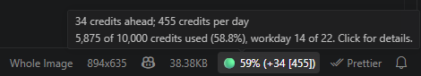
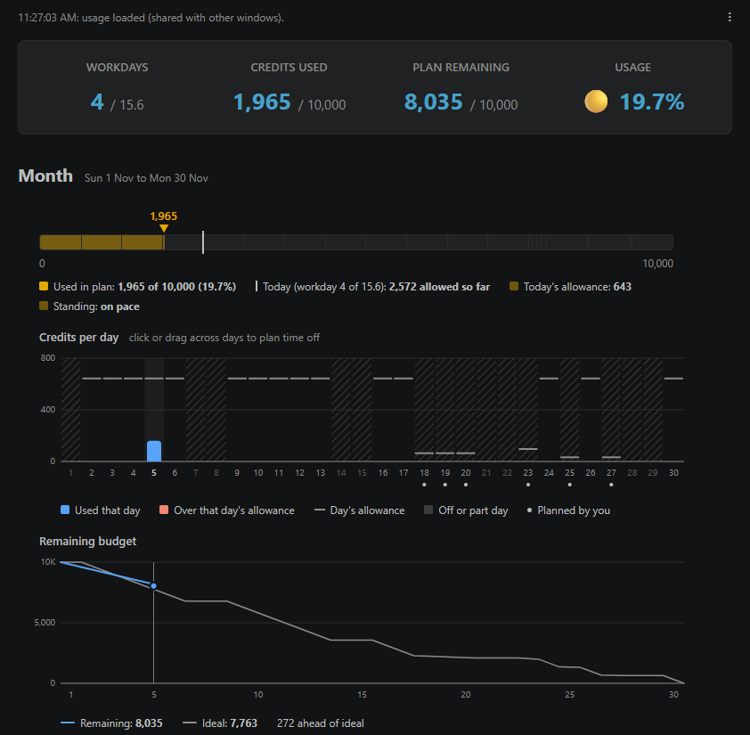

# Copilot Tracker Ent

[](https://marketplace.visualstudio.com/items?itemName=cri5ti.copilot-tracker-ent) [](LICENSE)

A VS Code status bar item that shows how many GitHub Copilot AI credits you have used this month, compared with how far through the month's workdays you are.

- **Pace against a plan:** the monthly budget is spread over your workdays, and you can mark days off or part days to redistribute it.
- **History:** usage is recorded locally on every change, so the panel can plot credits per day and per 15 minutes.
- **Trend charts:** remaining budget against the ideal line, for the month and for today.
- **Many windows, one fetch:** all VS Code windows share one refresh schedule instead of each calling GitHub.



**Enterprise only.** This extension is built for enterprise-managed GitHub accounts (for example `name_company` logins with a Copilot Business or Enterprise seat). It was not designed or tested for personal Copilot plans.

## What the status bar shows

```
🔴 59% (-2,848 [400])
🟡 59% (125 / 400)
🟢 59% (+1,284 [400])
```

`59%` is the share of your monthly credits used. `[400]` is today's allowance: the plan budget (by default the monthly limit) spread over the plan's workdays, weighted by any days off you planned. Today's slice of the budget runs from the allowance through yesterday to the allowance through today.

| Circle | Meaning | Status bar | Tooltip |
| --- | --- | --- | --- |
| 🟢 | Below today's slice: you are ahead | `(+1,284 [400])` | `1,284 credits ahead; 400 credits per day` |
| 🟡 | Inside today's slice | `(125 / 400)` | `125 credits today; 400 credits per day` |
| 🔴 | Above today's slice: you are over | `(-2,848 [400])` | `2,848 credits over; 400 credits per day` |

The tooltip also shows credits used, the limit, the workday count and, with a custom plan, how much of the plan budget is used.

## Panel

Click the status bar item for the full panel.



- **Month:** a bar from 0 to the plan budget, one tick per workday. The arrow shows credits used in the plan and the line marks the allowance through today.
  - **Credits per day:** a spike per day with the day's allowance as a short line. Spikes over the allowance are red. Click a day, drag across a range or shift-click to extend, then use the popup to switch the days on or off or set a part-day workload (0 to 100%). The budget is redistributed over the remaining workload. Weekends are off and weekdays on, unless you plan otherwise; **Weekday default** clears a planned day.
  - **Remaining budget:** what is left of the plan budget over the month, against the ideal line that spends each day's allowance evenly.
- **Today:** the same bar zoomed in on today's slice. The line is the time of day (the full bar on days off). If you are outside the slice, the arrow becomes a side arrow showing the credits ahead or over.
  - **Credits per 15 minutes** and **Remaining budget today**, the same two charts for today.
- **Plan** (bottom of the panel): a From and To date and a Budget. Every month starts with the 1st, the last day and the full limit. **Reset to today** gives you a fresh start: from today, with the credits remaining this month. **Month defaults** goes back to the whole month.
- A menu (the three dots, top right) with **Refresh**, **Re-authenticate** and **Logs**. The same actions are in the Command Palette under "Copilot Tracker Ent".

## Install

From the Marketplace: search for **Copilot Tracker Ent**, or run `ext install cri5ti.copilot-tracker-ent`.

From a `.vsix`: get it from the [releases page](https://github.com/cri5ti/copilot-credit-tracker/releases), or build it with `npm install` and `npx @vscode/vsce package`. In VS Code open Extensions, click `...`, choose **Install from VSIX...** and pick the file.

Then sign in to GitHub when prompted.

## Settings

| Setting | Default | Description |
| --- | --- | --- |
| `copilotTrackerEnt.monthlyLimit` | `7000` | Fallback monthly credit limit, used only if GitHub does not report one. |
| `copilotTrackerEnt.refreshIntervalMinutes` | `5` | How often usage is fetched from GitHub. |

## History and multiple windows

Each refresh is recorded in a local SQLite database (`history.sqlite` in the extension's global storage), shared by every VS Code window. A row is added only when the credits used change, together with the delta since the previous row. The charts are built from these rows, so they only show usage from when the extension was running.

All windows share one refresh schedule: every window checks the database each minute, but only one of them calls GitHub per refresh interval, and never more than once every 15 seconds, even if you press Refresh. The other windows pick up the result from the database. The planned days off and the plan are stored there too, so every window sees the same plan.

The database uses `node:sqlite`, which ships with recent VS Code versions. If it is not available the log says so and history is kept in memory for that window only.

## Limits

The quota endpoint is internal and undocumented, so GitHub can change it without notice. It reports only the current total, so history starts when you install the extension, and usage while VS Code is closed shows up on the day of the next refresh.

## Troubleshooting

Run **Copilot Tracker Ent: Show Log** from the Command Palette, or press **Logs** in the panel. It lists each GitHub request, its HTTP status, your GitHub login and the token scopes, plus your plan and quota figures. Tokens are never logged. Check the log before pasting it anywhere public.

## Privacy

The extension uses VS Code's built-in GitHub sign-in with the `read:user` scope and makes one call per refresh, to `https://api.github.com/copilot_internal/user`. The credit totals, your planned days and your plan are stored only in the local database described above. Nothing is sent anywhere else.

## Changelog

**0.3.0** adds the local usage history, the per-day and per-15-minute spike charts, the remaining-budget trend charts, planning of days off, the editable plan (From, To, Budget, Reset to today), a shared refresh schedule across windows and a new panel layout. See [CHANGELOG.md](CHANGELOG.md) for every release.

## Contributing

Build, test and release steps are in [DEV.md](DEV.md).

## Fork notice

This started as a fork of [0RuiAlvel0/copilot-credit-tracker](https://github.com/0RuiAlvel0/copilot-credit-tracker) and has since been rewritten as an enterprise-only extension.

## License

MIT. See [LICENSE](LICENSE).
