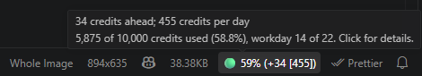
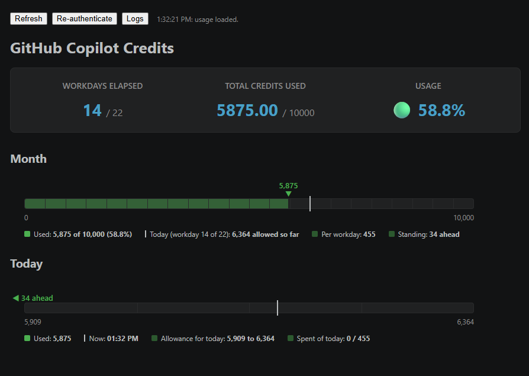

# Copilot Tracker Ent

[](https://marketplace.visualstudio.com/items?itemName=cri5ti.copilot-tracker-ent) [](LICENSE)

A VS Code status bar item that shows how many GitHub Copilot AI credits you have used this month, compared with how far through the month's workdays you are.



**Enterprise only.** This extension is built for enterprise-managed GitHub accounts (for example `name_company` logins with a Copilot Business or Enterprise seat). It was not designed or tested for personal Copilot plans.

## What the status bar shows

```
🔴 59% (-2,848 [400])
🟡 59% (125 / 400)
🟢 59% (+1,284 [400])
```

`59%` is the share of your monthly credits used. `[400]` is your daily allowance: the monthly limit spread over the month's workdays. Today's slice of the budget runs from the allowance through yesterday to the allowance through today.

| Circle | Meaning | Status bar | Tooltip |
| --- | --- | --- | --- |
| 🟢 | Below today's slice: you are ahead | `(+1,284 [400])` | `1,284 credits ahead; 400 credits per day` |
| 🟡 | Inside today's slice | `(125 / 400)` | `125 credits today; 400 credits per day` |
| 🔴 | Above today's slice: you are over | `(-2,848 [400])` | `2,848 credits over; 400 credits per day` |

The tooltip also shows credits used, the limit and the workday count.

## Panel

Click the status bar item for the full panel.



- **Month:** a bar from 0 to your limit, one tick per workday. The arrow shows credits used and the line marks the allowance through today.
- **Today:** the same view zoomed in on today's slice. The line is the time of day (the full bar on weekends). If you are outside the slice, the arrow becomes a side arrow showing the credits ahead or over.
- **Refresh**, **Re-authenticate** and **Logs** buttons. The same actions are in the Command Palette under "Copilot Tracker Ent".

## Install

From the Marketplace: search for **Copilot Tracker Ent**, or run `ext install cri5ti.copilot-tracker-ent`.

From a `.vsix`: get it from the [releases page](https://github.com/cri5ti/copilot-credit-tracker/releases), or build it with `npm install` and `npx @vscode/vsce package`. In VS Code open Extensions, click `...`, choose **Install from VSIX...** and pick the file.

Then sign in to GitHub when prompted.

## Settings

| Setting | Default | Description |
| --- | --- | --- |
| `copilotTrackerEnt.monthlyLimit` | `7000` | Fallback monthly credit limit, used only if GitHub does not report one. |

## Limits

The quota endpoint is internal and undocumented, so GitHub can change it without notice. It reports only the current total, with no history.

## Troubleshooting

Run **Copilot Tracker Ent: Show Log** from the Command Palette, or press **Logs** in the panel. It lists each GitHub request, its HTTP status, your GitHub login and the token scopes, plus your plan and quota figures. Tokens are never logged. Check the log before pasting it anywhere public.

## Privacy

The extension uses VS Code's built-in GitHub sign-in with the `read:user` scope and makes one call per refresh, to `https://api.github.com/copilot_internal/user`. Nothing is stored or sent anywhere else.

## Fork notice

This started as a fork of [0RuiAlvel0/copilot-credit-tracker](https://github.com/0RuiAlvel0/copilot-credit-tracker) and has since been rewritten as an enterprise-only extension.

## License

MIT. See [LICENSE](LICENSE).
